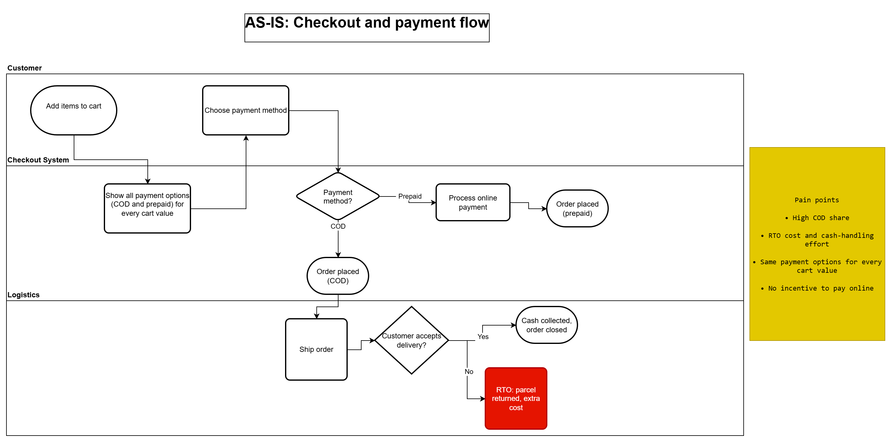
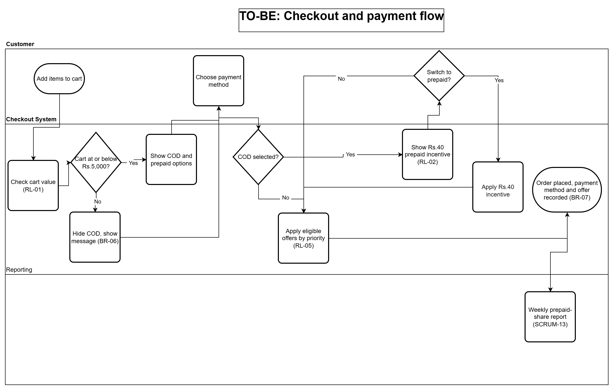

# Sample BRD: E-commerce Checkout & Payment Optimisation

> **Practice project.** Fictional company (Sample Apparel Co.), illustrative values and simulated stakeholders. It contains no real company data.

## What this is
A complete business analysis package for a checkout change that reduces cash-on-delivery (COD) risk and raises the share of prepaid orders. It follows one requirement from definition to tested go-live: BRD, process flows, user stories, UAT, a defect cycle and a requirements review.

## Business problem
A high COD share increases return-to-origin (RTO) orders, cash-handling effort and delivery cost, and customers have no clear incentive to pay online.

## What's inside

| Artifact | What it shows | File |
|---|---|---|
| Business Requirements Document (v0.2) | Objective, scope, stakeholders, 7 business requirements, 7 business rules, risks, sign-off and traceability | [BRD](Documents/BRD-Checkout-Payment-Optimisation-v0.2.pdf) |
| UAT test cases | 14 test cases, one failure found and retested | [UAT](Documents/UAT-Test-Cases-Checkout.pdf) |
| Requirements review (simulated) | 7 stakeholder questions, decisions, owners and actions that updated the BRD | [Review](Documents/Requirements-Review-Practice.pdf) |
| Process flows (AS-IS and TO-BE) | Swimlane diagrams drawn in draw.io | [Diagrams](Diagrams) |
| Jira project | Epic, 8 user stories with acceptance criteria, tasks, a bug and a completed sprint | [JIRA](JIRA) |

## Process flows
**AS-IS**

**TO-BE**

## How the pieces connect
- **7 business requirements** (BR-01 to BR-07) map to **8 user stories** in Jira, each with acceptance criteria.
- The stories map to **14 UAT test cases** (traceability table in section 2.13 of the BRD).
- UAT found **1 defect** (COD still shown above the limit). It was logged, linked to its story, fixed, retested and closed.
- The requirements review raised **7 questions**, which produced new rules (discount cap) and updated the BRD to **v0.2**.

## Jira evidence
- [Backlog and Sprint 1](JIRA/01-backlog-sprint-1.png)
- Board, all done: [part 1](JIRA/02-board-all-done-1.png), [part 2](JIRA/02-board-all-done-2.png), [part 3](JIRA/02-board-all-done-3.png)
- [All work items](JIRA/03-all-work-items.png)
- [Epic with stories](JIRA/04-epic-with-stories.png)
- [Story with acceptance criteria](JIRA/05-story-acceptance-criteria.png)
- Bug lifecycle: [part 1](JIRA/06-bug-lifecycle-1.png), [part 2](JIRA/06-bug-lifecycle-2.png)
- [Project overview](JIRA/project-and-team-overview.pdf)

## Tools
Jira (Scrum), Confluence, draw.io

## Skills demonstrated
Requirements gathering | Business rules definition | BRD writing | AS-IS and TO-BE process mapping | User stories and acceptance criteria | UAT and defect management | Requirements traceability | Stakeholder review | Sprint planning

## Author
Bharath G M | [LinkedIn](https://linkedin.com/in/bharath-gowdru)
